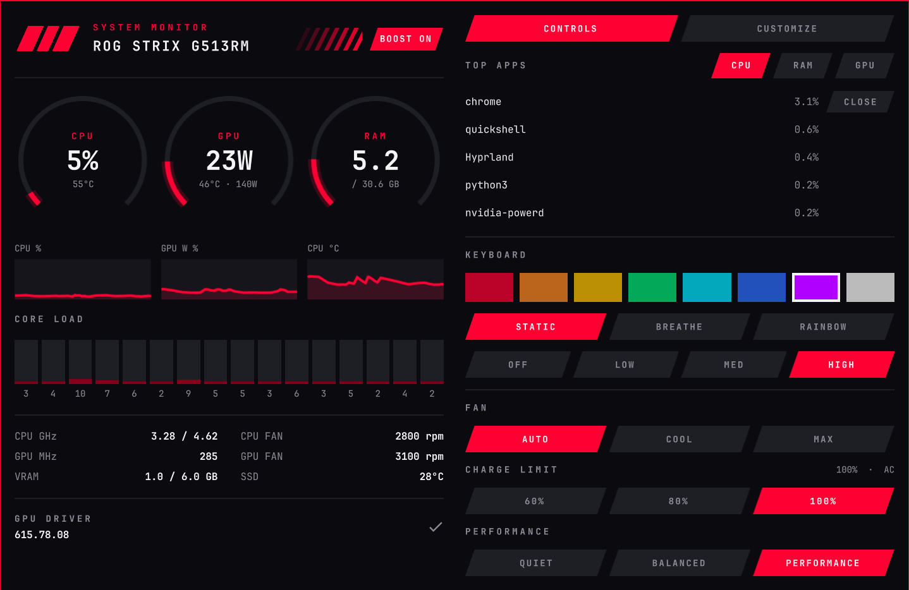

# ASUS ROG Monitor

A gaming-style system dashboard for the Omarchy bar on ASUS and ROG laptops: live gauges and one-click hardware controls.

**ASUS hardware only for now.** On other systems the panel stays blurred behind a notice, and the plugin reads no stats. Versions for other brands are planned.



## Features

- **Bar widget:** logo, CPU load and GPU power on one line
- **Gauges:** CPU load and temperature, GPU power and temperature, RAM
- **Live graphs:** CPU load, GPU power and CPU temperature for the last 60 seconds
- **Core load:** one bar per logical core
- **Details:** CPU and GPU clocks, VRAM, fan speeds and SSD temperature
- **Top apps:** heaviest applications by CPU, RAM or GPU, with a two-step close button
- **NVIDIA:** a `BOOST ON / OFF` label that shows when Dynamic Boost raises the power limit
- **GPU driver:** the running NVIDIA driver version with a single status icon. When Arch has a newer driver, a download icon appears and you get one desktop notification. The check uses `checkupdates` at most every six hours, even with the panel closed.

With `asusctl` installed, the panel also controls:

- Keyboard colour, effect and brightness
- Fan presets: `AUTO` (stock), `COOL` and `MAX`
- Battery charge limit: 60, 80 or 100%
- Performance profile: Quiet, Balanced or Performance

## Customize

Open the panel and choose **CUSTOMIZE**:

- **System color:** presets, a hue strip or any hex value (type it with the keyboard, Enter to apply). The whole panel, the bar labels and the logo follow it.
- **Keyboard color:** the same picker, for any colour your keyboard supports (needs `asusctl`)
- **Show in bar:** any mix of logo, CPU load, CPU temperature, per-core bars, RAM, GPU power and GPU temperature

## Install

```bash
omarchy plugin add https://github.com/0gulcandogann/asus-rog-monitor --enable
```

Omarchy reviews the plugin before installing it. You can then move the widget with `omarchy bar move io.github.0gulcandogann.asus-rog-monitor --section center`.

## Remove

```bash
omarchy plugin remove io.github.0gulcandogann.asus-rog-monitor
rm -rf ~/.local/state/asus-rog-monitor
rm -f ~/.config/omarchy/hooks/theme-set.d/asus-rog-monitor-keyboard
```

## Requirements

| Dependency | Needed for | Required |
|---|---|---|
| ASUS or ROG computer | Everything | Yes |
| `python3` | Reading system stats | Yes |
| `nvidia-smi` | GPU gauge, boost label, GPU top apps | No, these stay empty or hidden without it |
| `checkupdates` (`pacman-contrib`) | GPU driver update check | No, the icon stays hidden without it |
| `asusctl` (`asusd` running) | Keyboard, fan, charge limit and profile controls | No, hidden without it |

Dynamic Boost also needs `nvidia-powerd`: `sudo systemctl enable --now nvidia-powerd`.

## Optional settings

Add these to the widget's entry in `~/.config/omarchy/shell.json` to use your own logo and header text:

```json
{
  "id": "io.github.0gulcandogann.asus-rog-monitor",
  "logo": "/home/you/.config/omarchy/branding/my-logo.png",
  "title": "MY RIG",
  "logoTint": false
}
```

The logo takes the system colour by default. Set `logoTint` to `false` for a multi-colour image.

For a quiet, monochrome bar, add `"barStyle": "plain"`. The bar then shows only the temperatures, as `58° / 45°` (CPU / GPU), in the bar's own text colour, with no logo, labels or accent colour. A value over its alarm limit (CPU 90 °C, GPU 87 °C) switches to the bar's urgent colour.

The CPU temperature in the bar is an average of the last 5 seconds, sampled twice a second. Ryzen laptop CPUs swing by tens of degrees within seconds, so a single reading every few seconds jumped around. The panel still shows the instant value.

## Keep the keyboard colour after theme changes

Omarchy resets the keyboard colour whenever the theme changes. To restore your choice automatically, run this once from the plugin folder:

```bash
./install-theme-hook.sh
```

The plugin never installs this hook on its own.

## Notes

- The driver download icon opens Omarchy's normal update in a terminal, and you confirm it there. It updates the whole system because Arch does not support updating only the driver.
- `COOL` and `MAX` run the fans harder than the stock curves, so they are louder. They apply to the active performance profile. `AUTO` returns to stock.
- The close button sends `SIGTERM` to every process with that name. It is not offered for other users' processes or for core session processes such as Hyprland.
- Selections are stored in `~/.local/state/asus-rog-monitor/state.json`.
- Tested on one machine only: ASUS ROG Strix G513RM with an RTX 3060 on Omarchy. Bug reports from other hardware are welcome.

ASUS ROG Monitor is an independent community project. It is not made, affiliated with or endorsed by ASUSTeK Computer Inc., NVIDIA or Omarchy. ASUS and ROG are trademarks of ASUSTeK and are used here only to describe compatible hardware. The plugin does not include the ROG logo.

## License

[MIT](LICENSE). See [third-party notices](THIRD_PARTY_NOTICES.md).
